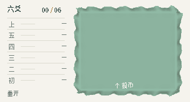
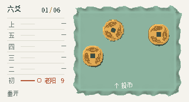
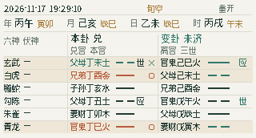
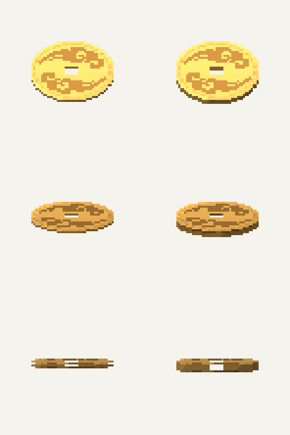

# 六爻排盘

三枚铜钱，六次投掷。铜钱翻转、落地和反弹后逐爻记录结果，完成六投后生成本卦及变卦。

 

首发页面 V95 固件模拟画面：连续两次投币，非实机录像。

## 排盘规则

- 初爻至上爻依次起卦；老阴和老阳为动爻。
- 京房纳甲、八宫世应、六亲、六神、伏神及四柱旬空。
- 变卦世应按变卦所属宫定位，六亲以本卦所属宫五行为基准。
- 首次投币锁定北京时间，00:00 换日；四柱含节气月柱。币面由软件伪随机生成。
- 有线校时已验证；完全断电后需重新校时。

## V99 铜钱改进

对比图左为 V98，右为 V99。其他界面预览来自 V95 布局，V99 延续该布局，不代表最新版本的实机摄影。

[核心源码](源码/) · [时钟与校时](源码/时钟与校时/) · [V99 整合版](V99整合固件/) · [第三方许可](第三方许可/) · [返回首页](../README.md)

## 文件说明

这里包含六爻的最终实现源码、界面与动画预览、校时实现、相关第三方许可，以及整个键盘三种模式共同使用的 V99 整合固件构建说明。源码为关键实现摘录，部分模块需要合法取得的原始工程依赖，并不是完整独立编译工程。
