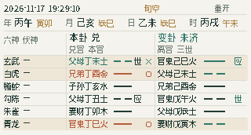
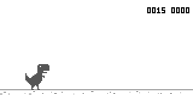

# Rainy75 V2 自定义屏幕
Rainy75 V2 键盘 320×172 IPS 屏幕的非官方自定义模式。三个模式已经整合进同一 **V99** 固件。

| 模式 | 效果与操作 |
| --- | --- |
| [小人眨眼](modes/01-blink/) | 按键互动、原厂状态栏 |
| [六爻投币](modes/02-liuyao/) | 铜钱动画、六次投币、纳甲排盘 |
| [恐龙跑酷](modes/03-dino/) | 随机障碍、跳跃、下蹲 |

## 最终版本
[V99 整合版说明、离线构建及验证记录](firmware/V99/)｜[最终源码](src/)

发布的是最终实现的源码摘录、预览和构建说明，不包含历史试验版本、原厂完整镜像及未确认可再分发的素材。暂无一键刷机包。
2026-11-18已有实机刷写、回读与有线走时记录；完全断电后续时仍未解决。

## 许可
原创部分暂未指定开放源码许可证；纳甲算法和Noto字体子集分别沿用其MIT及SIL OFL 1.1许可，见 [第三方许可](licenses/)。非官方项目，不代表键盘厂商。
