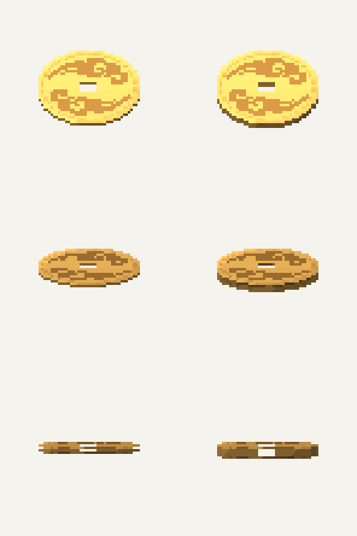

<h1 align="center">Rainy75 V2 · 自定义屏幕</h1>

方寸之间，亦有天地。

<b>六爻排盘</b>　/　恐龙跑酷　/　小人眨眼

320 × 172 IPS 屏幕 · V99 整合版 · 非官方个人改造

<a href="#一六爻排盘">六爻排盘</a> ｜ <a href="#二恐龙跑酷">恐龙跑酷</a> ｜ <a href="#三小人眨眼">小人眨眼</a> ｜ <a href="#最终版本与使用">最终版本</a>

---

## 一、六爻排盘

把传统铜钱起卦与纳甲排盘放进键盘屏幕。每次投掷三枚铜钱，共六次，模拟翻转、落地和反弹；六投完成后，在屏幕上并列展示本卦与变卦。

  
  

起卦准备 · 铜钱投掷

连续两次投币 · 原始画面模拟动图

本卦与变卦 · 模拟器预览（V95 布局，V99 延续）

**投币起卦**：三币六投，从初爻至上爻；使用软件伪随机产生币面，支持动爻和变卦。

**完整排盘**：京房纳甲、八宫、六亲、六神、世应、伏神、动爻，显示年、月、日、时四柱及旬空。

**起卦取时**：首次投币锁定北京时间，午夜零点换日；支持电脑有线校时。彻底断电后须重新校时。

**视觉设计**：立体铜钱、金属光照、云纹、桌布和碰撞反弹；V99 加强铜钱侧边的体积感。

首次 GitHub 发布的铜钱细节对比（左 V98，右 V99）

[模式详情与铜钱对比](模式/01_六爻排盘/) · [六爻相关源码](源码/六爻排盘/)

---

## 二、恐龙跑酷

复刻经典 Chrome 恐龙跑酷玩法；在键盘屏幕上躲避随机障碍，累积积分。**↑** 开始、跳跃或重开，**↓** 下蹲。

本模式参考并移植自 [pablosguajardo/esp32-chrome-dino-game](https://github.com/pablosguajardo/esp32-chrome-dino-game)，感谢原作者。本项目完成 Rainy75 V2 屏幕显示、按键输入、游戏调度与其他模式的整合适配，恐龙玩法及原始贴图不属于本项目原创。上游未声明明确的再分发许可证，仓库不单独提供其原始贴图与源码。

[模式详情与来源说明](模式/02_恐龙跑酷/)

---

## 三、小人眨眼

动画素材预览（非实机录像）

黑白线条小人，静置时周期性眨眼，敲击键盘可触发互动；结合原厂电量、充电和连接状态显示，适合作为日常待机界面。

[模式详情](模式/03_小人眨眼/)

---

## 最终版本与使用

当前最终整合版 **V99**，三个模式共用同一屏幕固件。2026-11-18 已完成实机刷写、全量回读校验与有线走时验证。

[最终固件说明与构建方式](固件/V99/) · [核心实现源码](源码/) · [第三方许可与致谢](第三方许可/)

目前公开最终源码摘录、预览和离线构建脚本；因原厂及第三方完整镜像的分发权未核实，暂不提供可直接刷入的完整固件。构建脚本需要合法取得且摘要完全匹配的 V98 基线。刷机有风险，请先确认设备与恢复方案。

## 作者与使用许可

Copyright © 2026 [yyc2216](https://github.com/yyc2216)

本项目原创部分允许个人学习、非商业使用、修改和免费分享；转载或二次发布须明确署名并链接原项目，禁止未经作者书面许可的商业使用或盈利。详见 [署名—非商业使用许可](LICENSE.md)。

第三方代码及素材仍适用各自权利及许可，不因本仓库许可而改变。此项目与键盘厂商或 Google 无官方关联。
