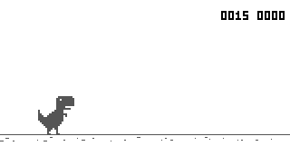

# 恐龙跑酷

方向键 ↑ 开始、跳跃、重开；↓ 下蹲。随机障碍、跑动动画、碰撞及计分。该图为真实 ARM 指令模拟预览，长短按跳跃高度差异尚未实机确认。

## 来源与致谢

原参考项目：[pablosguajardo/esp32-chrome-dino-game](https://github.com/pablosguajardo/esp32-chrome-dino-game)（ESP32-S3 + ST7789 平台）。经典游戏最初来自 Google Chrome。

本模式借鉴、移植上游的游戏设计及原始贴图，在 Rainy75 V2 上重新适配屏幕缓冲与刷新、键盘输入、固定时钟步长和模式生命周期。原玩法及原始图形资源不属于本项目原创。

已核查上游仓库未标明许可证；本公开仓库不单独分发其原始源码和贴图包，也不对它们授予任何新许可。游戏预览仅用于说明移植效果及来源；若需原项目内容，请联系或遵循相应权利人的许可。

[V99 整合版](../../固件/V99/) · [第三方许可](../../第三方许可/) · [返回首页](../../README.md)
